# Control predictivo con aprendizaje sobre un péndulo invertido

Trabajo Práctico Integrador de Control Predictivo (FICH-UNL), de Mateo Dayub y Agustín Marzioni.

## De qué se trata


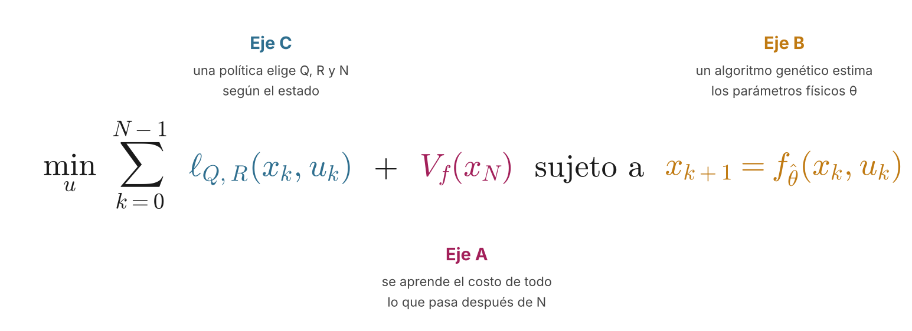

En el eje A aprendemos el costo terminal. En el eje B estimos en línea los parámetros físicos para que el modelo del MPC se parezca a la planta. En el eje C dado el estado del sistema se elige con qué pesos y horizonte trabaja el MPC en cada momento.

## La base común

Los tres ejes usan el mismo simulador y el mismo MPC, que están en `simulador/`.

`pendulo_env.py` es la planta no lineal carro-péndulo escrita como entorno de Gymnasium (`PenduloGazebo-v0`). Replica la planta de Gazebo del repo de ROS 2, con un carro de 3 kg, un péndulo de 1 kg y 0,5 m, riel de ±0,5 m, fuerza máxima de 100 N y período de control de 20 ms. El estado es $s = (x, \dot x, \theta, \dot\theta)$ con $\theta = 0$ en la vertical, y el episodio se da por perdido si el péndulo pasa los 46° o el carro se sale del riel.

`mpc_no_lineal.py` arma el MPC en CasADi, discretiza con RK4 y resuelve con Ipopt usando *warm start*. El costo de etapa es cuadrático con $Q = \mathrm{diag}(10, 1, 100, 1)$ y $R = 0{,}1$, y el costo terminal es enchufable, cualquier función de $x_N$ que devuelva una expresión de CasADi. Eso es justamente lo que cambia entre los métodos del eje A.

---

## Eje A. Costo terminal aprendido

### ¿Qué pasa después del horizonte?

El MPC optimiza $N$ pasos, pero el péndulo no se termina en el paso $N$. Todo lo que pasa después lo tiene que resumir el costo terminal $V_f(x_N)$. Lo clásico es usar $x^\top P x$ con $P$ sacada de Riccati, que es el costo exacto **si el sistema fuera lineal y no tuviera restricciones**. Lejos del equilibrio ninguna de las dos cosas es cierta, el péndulo es no lineal y el riel se termina. La pregunta del eje A es si podemos aprender ese costo a futuro directamente del sistema no lineal con sus restricciones.

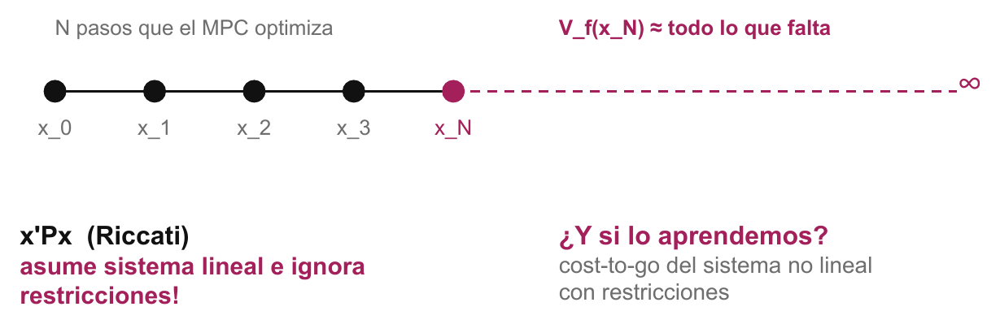

### Un MPC es un operador de Bellman

El operador de Bellman $\mathcal{T}$ toma una función de valor $V$ y devuelve otra, $(\mathcal{T}V)(x) = \min_u \left[\ell(x,u) + V(f(x,u))\right]$. Aplicarlo una y otra vez hasta que no cambie más es la iteración de valor, y el punto fijo $V^{\ast} = \mathcal{T}V^{\ast}$ es el costo a futuro óptimo.

La observación clave es que resolver un MPC de horizonte $N$ con costo terminal $V$ es exactamente aplicar $N$ veces ese operador. El costo es una suma, la cola de la suma es otro MPC un paso más corto, y por inducción cada paso agrega un $\mathcal{T}$.

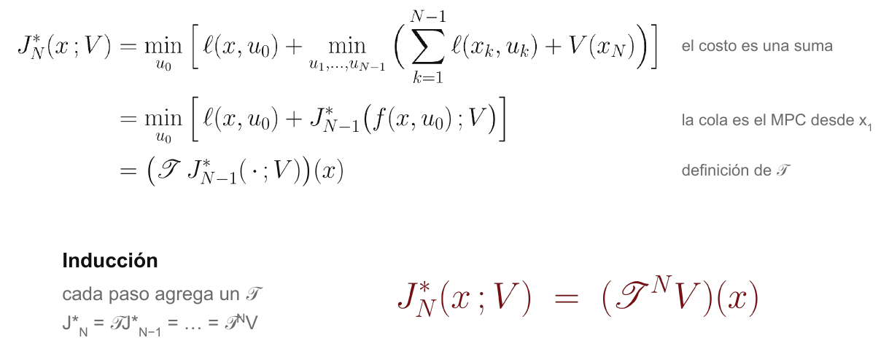

Entonces no hace falta implementar Bellman aparte. El MPC que ya tenemos **es** el operador.

### Iteración de valor con el MPC adentro

Se muestrea una sola vez una nube de estados. En cada iteración se resuelve el MPC desde cada estado usando como costo terminal la red actual, y el costo óptimo que devuelve Ipopt es el *target* de ese estado. Después se ajusta la red a esos targets por regresión (300 pasos de Adam sobre el error en escala logarítmica), se copian los pesos a CasADi, se rearma el MPC y se repite. Los estados que el MPC no puede recuperar no tienen un valor finito, así que su target se satura en $V_{max}$.

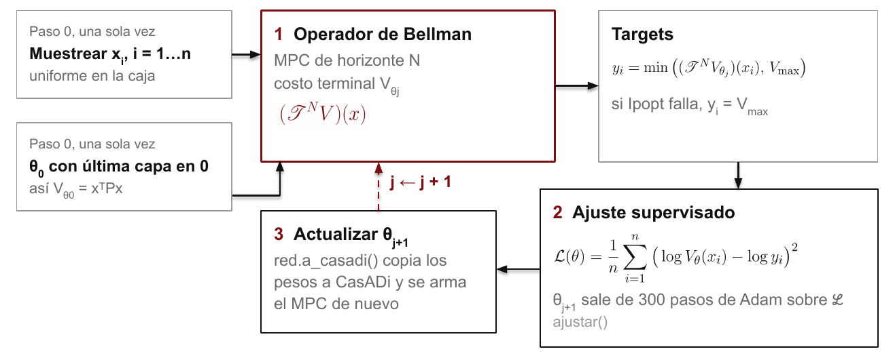

### Cómo está armada la red de valor

La red no aprende el valor desde cero. Arranca de lo que ya sabemos y aprende solo la corrección.

$$V_\psi(x) = x^\top P x \cdot \exp\big(\varphi_\theta(x \oslash e)\big)$$

$x^\top P x$ es la parte fija de Riccati y $\varphi_\theta$ es una MLP chica (4 → 64 → 64 → 1 con tanh) cuya última capa arranca en cero, así que en la iteración 0 la red vale exactamente $x^\top P x$. La corrección es multiplicativa y no sumada porque el valor va de ~1 cerca del equilibrio a ~10⁴ lejos, y con un error relativo se cuida el comportamiento local. Además Ipopt necesita gradiente y Hessiano, que CasADi saca por diferenciación automática, así que la red tiene que ser suave. Por eso tanh y exp, y nada de ReLU.

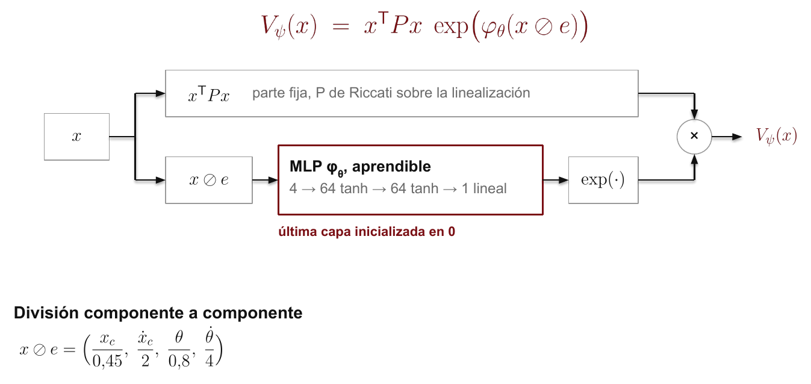

### Resultados

La región de recuperación es el conjunto de estados iniciales desde los que el péndulo vuelve al equilibrio. La medimos en una grilla de 225 estados del plano $(\theta_0, \dot x_0)$. Con horizonte $N = 1$, sin costo terminal se recupera 1 solo estado, con $x^\top P x$ se recuperan 89 y con $V_\psi$ se recuperan **103**, más que los 95 que logra $x^\top P x$ con un horizonte cinco veces más largo.

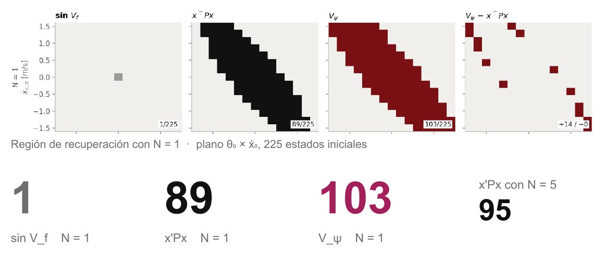

Mirando las trayectorias se ve que $V_\psi$ aprendió algo que Riccati no puede saber, que el riel termina. Frena antes al carro en los casos donde $x^\top P x$ lo deja irse de largo. Y la mejora sale casi gratis, el solve medio con $V_\psi$ tarda unos 6 ms dentro de un período de control de 20 ms. Todas las figuras del eje A están en `Inciso_A/figuras/`.

**Lo que mostramos.** $V_\psi$ ve las no linealidades y las restricciones, da más región de recuperación con menos horizonte y cuesta poco cómputo. **Lo que falta.** Una garantía formal de estabilidad (Lyapunov, conjunto terminal), robustez ante error de modelo y validación en Gazebo.

---

## Eje B. Estimación de parámetros físicos con un algoritmo genético

### El problema

El MPC predice con un modelo, y ese modelo depende de la masa del carro $M$, la masa del péndulo $m$, el largo $L$ y el radio $r$. Si la planta real es distinta de la nominal, el MPC predice mal, gasta más energía de la necesaria y en el peor caso deja caer el péndulo. La idea del eje B es corregir esos parámetros en línea mientras el sistema funciona.

### Planteado como un problema de RL

El **entorno** es la simulación no lineal bajo excitación persistente. La **observación** es el estado actual, la última fuerza aplicada, el error entre lo que predijo el modelo y lo que pasó en la planta, y los parámetros estimados hasta ahora. El **agente** es una red estimadora (MLP de 13 → 32 → 32 → 4 con tanh, 1636 pesos) y la **acción** es una corrección incremental $\Delta\hat\theta$ de los parámetros, que se amortigua sola cuando el error de predicción se hace chico.

Para entrenarla elegimos neuroevolución en lugar de RL basado en gradientes. Un algoritmo genético trata a la red como caja negra, no necesita derivar la física ni tener una expresión cerrada del error, puntúa trayectorias completas y explora varias regiones del espacio de pesos a la vez, lo que lo hace menos sensible a óptimos locales y recompensas ruidosas.

### El ciclo evolutivo

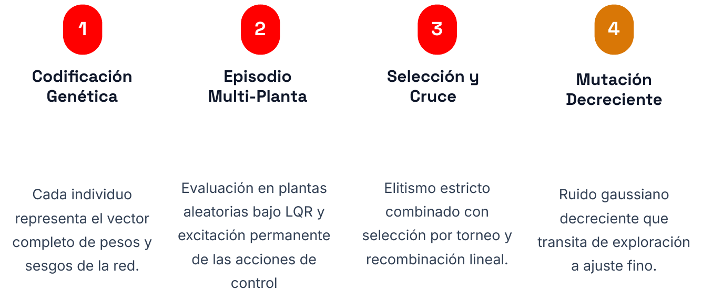

Cada individuo es un cromosoma con todos los pesos y sesgos de la red concatenados en un único vector real. Para evaluarlo se reconstruye la red y se la pone a estimar en un lote de plantas con $M$, $m$, $L$ y $r$ perturbados, mientras un LQR nominal estabiliza el péndulo y una señal multisenoidal lo excita para que los parámetros se puedan identificar. El fitness es el error histórico de los parámetros estimados, ponderado para darle más peso al final del episodio.

La nueva generación se arma con elitismo estricto (los mejores pasan directo), selección por torneo, cruce por mezcla lineal $\alpha \cdot p_1 + (1-\alpha) \cdot p_2$ con $\alpha$ al azar entre −0,25 y 1,25, y mutación gaussiana sobre una máscara aleatoria de genes con una amplitud que decrece de 0,15 a 0,01 a lo largo de las generaciones, pasando de explorar a ajustar fino. Por defecto son 60 individuos, 120 generaciones, 6 plantas por generación y 300 pasos por episodio.

### En lazo cerrado

Una vez entrenada, la red queda dentro del lazo. El predictor interno compara el paso que predijo el modelo con el que dio la planta, la red usa ese error para corregir $\hat\theta$, y el MPC relinealiza con los parámetros nuevos antes de optimizar la próxima acción.

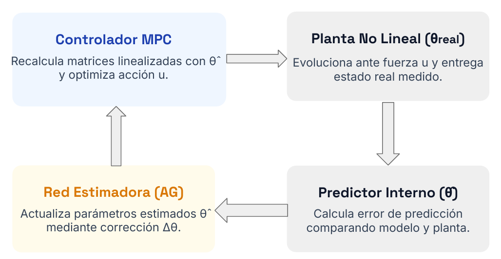

### Resultados y problemas

En una planta pesada y larga ($M = 4{,}6$ kg, $m = 1{,}55$ kg, $L = 0{,}78$ m) la estimación de $M$ llega al valor real, mientras que $m$ y $L$ se quedan a mitad de camino (cerca de 20 % de error). Aun así el error de predicción cae mucho respecto del modelo nominal, el error de ángulo baja de 2,7° a 1,7° y la energía de control se reduce a menos de la mitad, acercándose a un MPC "oráculo" que conoce los parámetros reales.

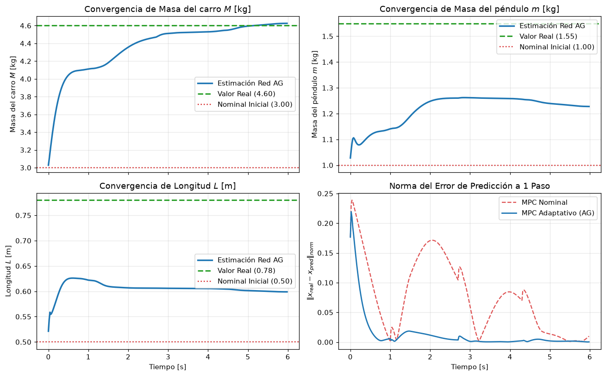

No todo es color de rosa. En una batería de 10 plantas al azar el seguimiento de posición queda prácticamente igual que con el MPC nominal, y en general apenas peor. Creemos que la red encuentra un máximo local que es "suficientemente bueno" para que el MPC no deje caer el péndulo, sin necesidad de clavar todos los parámetros. Para mejorar habría que probar una red más grande, más generaciones e individuos, y sobre todo sumar un método de explotación local después del AG, porque el algoritmo genético es muy bueno explorando pero no tanto refinando una solución.

---

## Eje C. Una política que elige con qué ajuste trabaja el MPC

### La idea

Un MPC con pesos agresivos reacciona rápido pero puede pasarse, uno conservador cuida la fuerza pero llega tarde, uno con horizonte largo ve más lejos pero cuesta más calcular. Ninguno es el mejor en todos lados. El eje C busca una función que, dado el estado del péndulo, elija cada 200 ms (cada $M = 10$ pasos de control) con qué ajuste $\vartheta = (Q_{mpc}, R_{mpc}, N)$ trabaja el MPC.

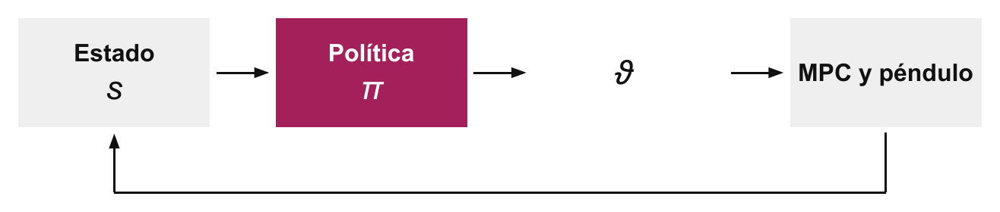

Eso es exactamente un problema de aprendizaje por refuerzo. El agente es la política, el entorno es el MPC con el péndulo, el estado es $s$ y la acción es el ajuste.

### Un poco de RL

Una **política** $\pi$ dice qué acción tomar en cada estado. La **recompensa** $r_k$ mide qué tan bien salió cada intervalo y el **retorno** $G_k = \sum_j \gamma^j r_{k+j}$ suma las recompensas futuras, pesando menos las más lejanas con $\gamma \in [0,1)$.

La **función de valor de acción** $Q^\pi(s,a)$ es el retorno esperado si en el estado $s$ usamos la acción $a$ y de ahí en adelante seguimos con $\pi$. Separando el primer término queda una ecuación recursiva, lo que vale hoy es la recompensa de hoy más lo que vale mañana.

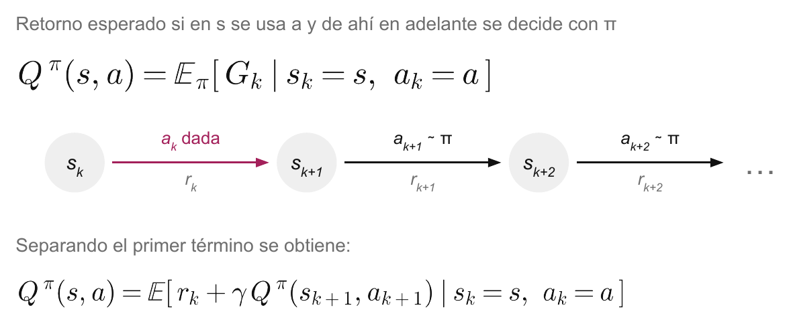

La función $Q^{\ast}$ de una política óptima cumple $Q^{\ast}(s,a) = \mathbb{E}\left[r_k + \gamma \max_{a'} Q^{\ast}(s_{k+1}, a')\right]$. Y lo bueno es que si la conocemos, la política óptima sale gratis, en cada estado se elige la acción con el $Q^{\ast}$ más alto, $\pi^{\ast}(s) = \arg\max_a Q^{\ast}(s,a)$.

### Dos caminos, y por qué elegimos aproximar el valor

Hay dos grandes familias. *Policy gradient* parametriza la política directamente y la empuja hacia más retorno, y anda mejor con acciones continuas. *Value function approximation* aproxima $Q^{\ast}$ con un regresor y actúa con el argmax, y es lo natural cuando hay pocas acciones discretas. Nosotros tenemos 4 ajustes, así que fuimos por el segundo.

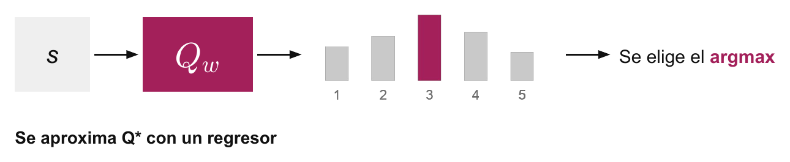

Todo el eje C depende entonces de esa caja que dice "se aproxima $Q^{\ast}$ con un regresor". Vale la pena frenar y entender bien qué hace.

### El regresor, explicado con calma

**Qué es un regresor.** Es una máquina de ajustar funciones a datos. Le damos una nube de puntos, donde cada punto tiene una entrada y una salida medida, y nos devuelve una función que pasa lo más cerca posible de esos puntos. Lo útil es que después le podemos preguntar por entradas que nunca vio, y nos contesta con lo que aprendió de los vecinos. En nuestro caso la entrada es un estado del péndulo junto con un ajuste del MPC, y la salida es cuánto vale usar ese ajuste en ese estado.

El ejemplo más simple de regresor es la regresión lineal, que ajusta una recta (o un plano). Acá no alcanza, y se ve enseguida con un ejemplo en una dimensión. La nube de abajo imita cómo se ve el valor a lo largo del ángulo inicial. Cerca de la vertical el péndulo se recupera y el valor anda cerca de 0, pero pasado cierto ángulo se cae y el valor se desploma a −20. Es una meseta con dos acantilados.

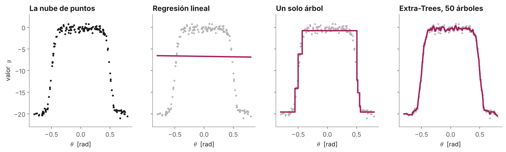

La recta no tiene forma de seguir esa forma y termina pasando por el medio, prediciendo un valor mediocre en todos lados. Pero hay un problema todavía peor. Si $Q$ fuera lineal, sería algo del estilo $w \cdot s + c_a$, una parte que depende del estado más una constante por cada ajuste. Al tomar el argmax, la parte del estado es la misma para los cuatro ajustes y se cancela, así que **la política elegiría siempre el mismo ajuste, sin importar el estado**. Justo lo contrario de lo que queremos. Necesitamos algo bastante más flexible.

**Un árbol de regresión.** Un árbol responde haciendo preguntas de sí o no sobre la entrada, del estilo "¿el ángulo es menor a −0,54?". Cada respuesta lo manda por una rama distinta hasta llegar a una hoja, y en cada hoja guarda el promedio de los puntos de entrenamiento que cayeron ahí. Ese promedio es la predicción.

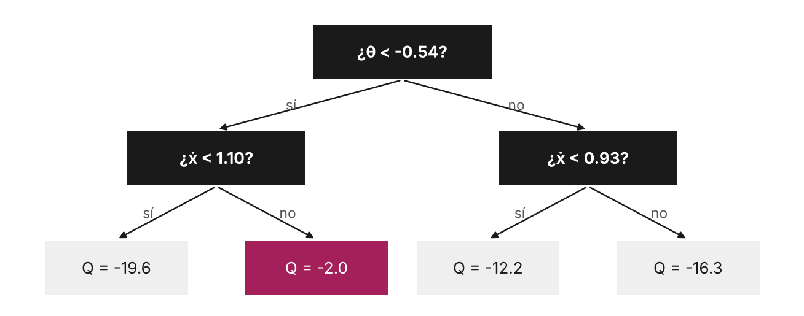

Cada pregunta corta el espacio con una línea recta paralela a un eje, así que un árbol divide el espacio en rectángulos y le asigna un valor constante a cada uno. La función que resulta es **constante por partes**, una escalera. Con pocas preguntas la escalera es muy gruesa, y con muchas puede seguir formas raras, como la franja diagonal que forman los estados recuperables en el plano $(\theta, \dot x)$.

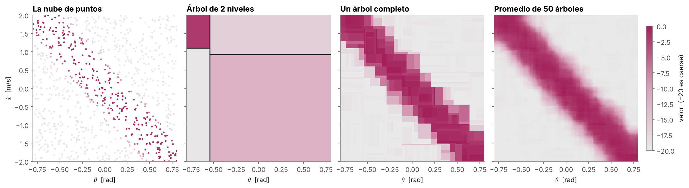

**Extra-Trees, un bosque de árboles con azar.** Un árbol solo es muy nervioso, si cambian un poco los datos cambian mucho sus cortes. *Extremely Randomized Trees* arma muchos árboles (usamos 50) y en cada nodo elige los cortes con una dosis de azar, sortea umbrales candidatos y se queda con el que mejor separa los datos. Cada árbol termina cortando en lugares distintos, y la predicción final es el promedio de todos. Promediar 50 escaleras con escalones en lugares distintos da una escalera de escalones muy finos, casi suave, que sigue bien los acantilados y es mucho menos sensible al ruido. Se ve en el último panel de las dos figuras de arriba. Sigue siendo constante por partes, pero con tantas partes que en la práctica se comporta como una función suave que no le tiene miedo a los saltos.

Para FQI tiene además ventajas prácticas. No necesita gradientes, se entrena en segundos, tiene muy pocos hiperparámetros (cantidad de árboles y cuántos puntos mínimos hacen falta para cortar un nodo, 4 en nuestro caso) y es el regresor con el que se propuso FQI originalmente.

**Qué le entra y qué le sale.** La entrada son 8 números, los 4 del estado y el ajuste codificado *one-hot* (un 1 en la posición del ajuste y 0 en el resto). La salida es un solo número, $Q(s,a)$. Para decidir, se le pregunta 4 veces con el mismo estado y cada uno de los ajustes, y se usa el que dio más alto.

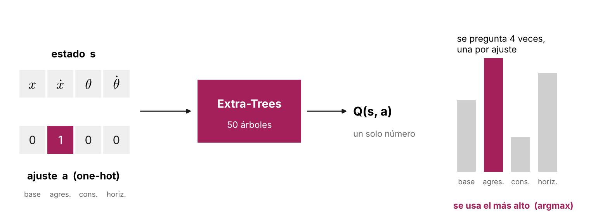

### Las acciones, el estado y la recompensa

Creamos 4 ajustes que difieren en una sola cosa respecto del base. Cada uno lleva su propio costo terminal $x^\top P_\vartheta x$ con la $P$ de Riccati para sus pesos, porque sin costo terminal un horizonte de 10 pasos (0,2 s) es demasiado miope.

| Ajuste      | $Q_{mpc}$           | $R_{mpc}$ | $N$ |
| ----------- | ------------------- | --------- | --- |
| base        | diag(10, 1, 100, 1) | 0,1       | 10  |
| agresivo    | diag(10, 1, 400, 4) | 0,1       | 10  |
| conservador | diag(10, 1, 100, 1) | 1,0       | 10  |
| horizonte   | diag(10, 1, 100, 1) | 0,1       | 20  |

El estado es $s = (x, \dot x, \theta, \dot\theta)$, muestreado en la caja $\pm(0{,}45;\ 2;\ 0{,}8;\ 4)$.

Para la recompensa se simulan los $M$ pasos con el ajuste elegido y se suma el costo del intervalo, siempre con la **métrica fija** del entorno ($Q$ y $R$ originales) y no con los pesos del ajuste, para que todos se comparen con la misma vara. Ese costo se normaliza por $\bar c$ (el percentil 99 del costo de los intervalos sin falla) y se recorta, $r_k = -\min(\text{costo}_k / \bar c,\ 1) \in [-1, 0]$. Si el péndulo pasa los 46°, el carro se sale del riel o Ipopt no converge, la transición es terminal y vale $r_k = -1/(1-\gamma) = -20$ con $\gamma = 0{,}95$, que es lo mismo que perder −1 para siempre.

### Cómo se aprende Q\*. Fitted Q Iteration

Para estimar $Q^{\ast}(s_k, a_k)$ con la ecuación de Bellman hacen falta cuatro cosas, un estado, una acción, la recompensa y el máximo de $Q^{\ast}$ en el estado siguiente. Las tres primeras se pueden juntar simulando y guardando tuplas $(s_i, a_i, r_i, s'_i)$. La cuarta no la tenemos, pero podemos reemplazarla por el máximo de nuestra estimación actual. Eso da una mejora recursiva.

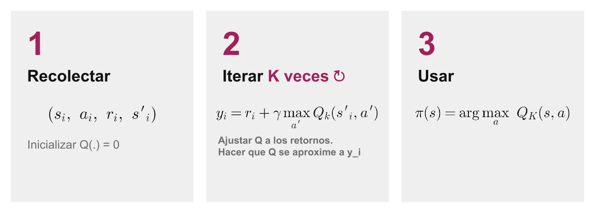

Se arranca con $Q = 0$, así que el primer objetivo de cada tupla es simplemente su recompensa. Se ajusta el regresor a esos objetivos, se recalculan $y_i = r_i + \gamma \max_{a'} Q(s'_i, a')$ con el regresor nuevo (sin el segundo término si la transición fue terminal) y se vuelve a ajustar. Las entradas del regresor son siempre las mismas, lo que cambia en cada vuelta son las alturas de la nube.

El ejemplo de juguete de abajo muestra qué pasa con esas alturas. Es un sistema inestable en una dimensión donde cerca de los bordes se cae enseguida. En la iteración 0 solo saben que son malos los estados que se caen en un paso. En cada vuelta esa información viaja un paso más hacia adentro, porque un estado que lleva a un estado malo también es malo, y el regresor se reajusta a la nube nueva hasta que deja de cambiar.

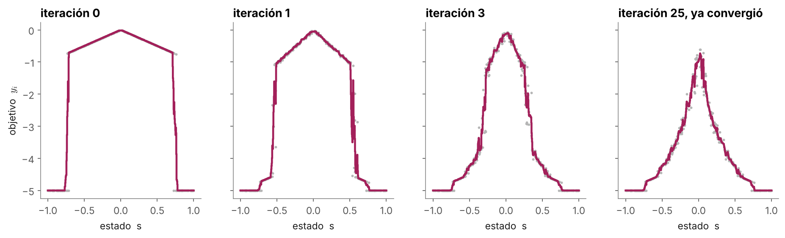

**Las dos fases.** Si en cada iteración se arma un bosque nuevo, los cortes dependen de los objetivos y no hay garantía de que la iteración converja. Por eso durante las primeras 20 iteraciones se reconstruye el bosque de cero, y a partir de ahí se congela la estructura (dónde corta cada árbol) y solo se recalcula el promedio de cada hoja. Con los cortes fijos cada predicción pasa a ser un promedio ponderado fijo de los objetivos, el operador de FQI se vuelve una contracción de módulo $\gamma$ y converge. Se ve en la curva, el cambio máximo de los objetivos queda estancado mientras el bosque se reconstruye y se desploma apenas se congela.

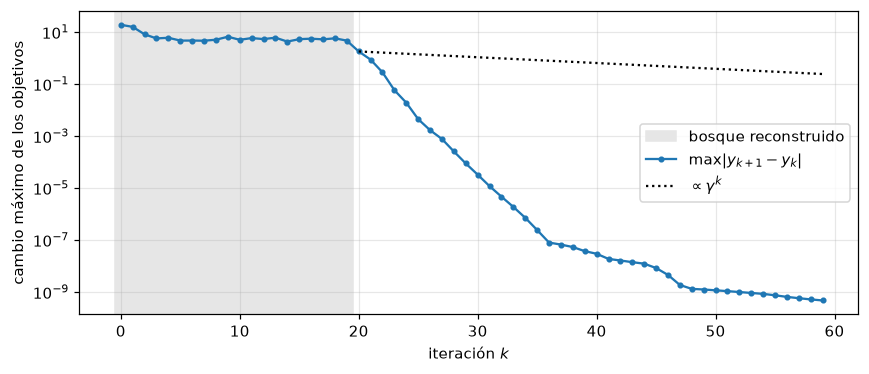

### El pipeline completo

La gracia de FQI es que se simula **una sola vez**. Se compilan los 4 MPC y se juntan transiciones de dos maneras, un lote sincrónico donde 2000 estados al azar se prueban con los 4 ajustes, y 200 episodios donde el ajuste se sortea en cada decisión, para cubrir los estados por donde pasan las trayectorias reales. Como el sistema es simétrico, cada transición $(s, a, r, s')$ tiene su espejo $(-s, a, r, -s')$ y se duplican los datos gratis. En total son unos 92 mil pasos de control simulados en 7 minutos. Después FQI itera sin volver a simular, en segundos por iteración.

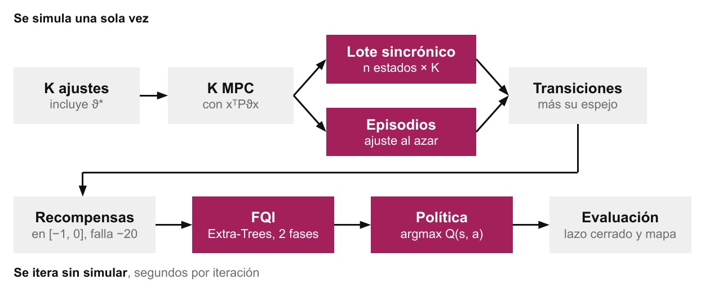

### Qué aprendió

Los mapas muestran, en dos cortes del espacio de estados, qué ajuste elige la política, cuánto vale el mejor ($V(s) = \max_a Q(s,a)$) y el margen entre el mejor y el segundo. $V$ dibuja bien la franja diagonal de estados recuperables. La política usa "horizonte" en la mayor parte del espacio y "agresivo" en varias zonas de la franja. Donde el margen es casi cero cualquier ajuste da lo mismo, y los manchones de colores ahí son ruido del regresor.

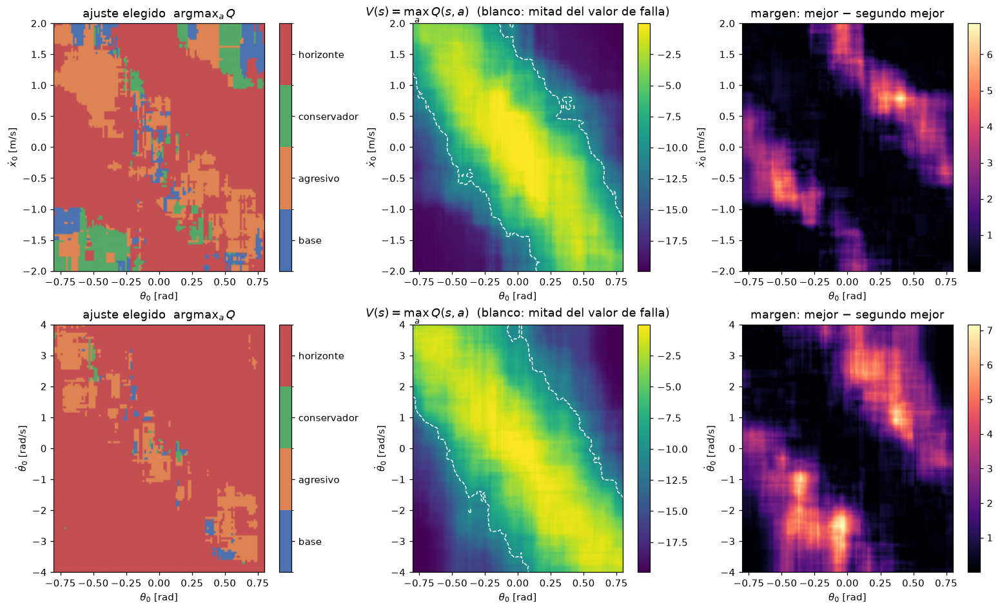

### Resultados en lazo cerrado

Comparamos la política FQI contra cada ajuste fijo, en una grilla de 169 estados iniciales del plano $(\theta_0, \dot x_0)$ y en 150 estados al azar de la caja de entrenamiento, simulando 5 s. El costo medio se compara solo sobre los 32 estados que estabilizan todas las políticas, porque un episodio que termina antes acumula menos costo.

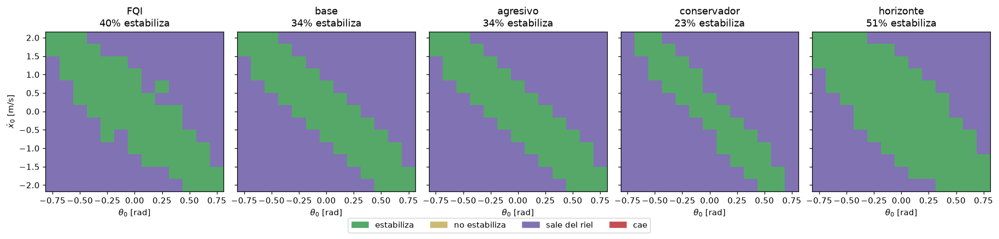

| Política    | Estabiliza (grilla) | Estabiliza (al azar) | Costo medio |
| ----------- | ------------------- | -------------------- | ----------- |
| FQI         | 40 %                | 44,0 %               | 431         |
| base        | 34 %                | 37,3 %               | 424         |
| agresivo    | 34 %                | 38,7 %               | 436         |
| conservador | 23 %                | 21,3 %               | 461         |
| horizonte   | 51 %                | 48,7 %               | 424         |

Casi todos los fracasos son por salirse del riel, no porque el péndulo se caiga.

### Conclusiones del eje C

**Lo que mostramos.** FQI con Extra-Trees aprende una función de valor con sentido físico, separa con claridad los estados recuperables de los que no, y la política resultante recupera más estados que tres de los cuatro ajustes fijos. Además el pipeline es barato, se simula una vez y se itera en segundos.

**Lo que falta.** La política no le gana al mejor ajuste fijo, que es "horizonte". Como ese ajuste es el mejor en casi todo el espacio, elegir aporta poco, y en las zonas donde el margen es casi cero el ruido del regresor hace que la política cambie de ajuste unas 7 veces por episodio, y cada cambio reinicia el *warm start* del MPC nuevo. Para seguir, nos parece que vale probar penalizar los cambios de ajuste (o meter el ajuste anterior en el estado), juntar más datos cerca de la frontera de la franja, usar ajustes más distintos entre sí y validar en Gazebo.

---

## Estructura del repo

```
simulador/
  pendulo_env.py           planta no lineal carro-péndulo como env de Gymnasium
  mpc_no_lineal.py         MPC no lineal en CasADi, RK4 e Ipopt con warm start
mpc_no_lineal.ipynb        pruebas en lazo cerrado, LQR contra MPC sin V_f y con x'Px

Inciso_A/                  eje A, costo terminal aprendido
  valor_aprendido.py       red V_psi e iteración de valor con el MPC como operador de Bellman
  region_recuperacion.py   barrido de la región de recuperación
  visualizaciones.py       genera las figuras de Inciso_A/figuras
  animaciones.py           genera los GIF
  demo_vpsi_vs_xpx.ipynb   demo comparando V_psi contra x'Px
  modelos/V_psi_N5_s0.pt   red entrenada

Inciso_B/                  eje B, estimación de parámetros con AG
  Algoritmo_Genetico.py    red estimadora, escenarios, fitness y AG
  evaluador_mpc.py         MPC adaptativo, nominal y oráculo en lazo cerrado
  experimentos_mpc_adaptativo.ipynb   pruebas y animación

inciso_C/                  eje C, elección del ajuste con FQI
  fqi_ajuste.py            recolección, recompensas, FQI con Extra-Trees y evaluación
  resultados_fqi.ipynb     mapas, convergencia y comparación en lazo cerrado
  fqi_s0.pkl               modelo entrenado

docs/img/                  imágenes de este README
```

## Cómo correrlo

```bash
python -m venv .venv
source .venv/bin/activate        # en Windows .venv\Scripts\activate
pip install -r requirements.txt
pip install scikit-learn pandas  # para el eje C
```

El MPC solo, desde la raíz del repo.

```python
import sys; sys.path.insert(0, "simulador")
import gymnasium as gym
import pendulo_env
from mpc_no_lineal import MPCNoLineal, riccati, costo_terminal_cuadratico

env = gym.make("PenduloGazebo-v0")
p = env.unwrapped.p
P, K = riccati(p)
mpc = MPCNoLineal(p, N=23, costo_terminal=costo_terminal_cuadratico(P))

estado, _ = env.reset(options={"estado": [0, 0, 0.5, 0]})
F = mpc.solve(estado)
```

Cada eje por separado.

```bash
# Eje A, entrenar V_psi y generar las figuras
python Inciso_A/valor_aprendido.py --N 5 --estados 1000
python Inciso_A/visualizaciones.py

# Eje B, el entrenamiento y las pruebas están en el notebook
jupyter notebook Inciso_B/experimentos_mpc_adaptativo.ipynb

# Eje C, recolectar datos, correr FQI y guardar inciso_C/fqi_s0.pkl
python inciso_C/fqi_ajuste.py --estados 2000 --episodios 200 --iteraciones 60
jupyter notebook inciso_C/resultados_fqi.ipynb
```

Los pesos de la red estimadora del eje B se guardan como `.npz`, que está en el `.gitignore`, así que la primera vez el notebook entrena el AG desde cero. `fqi_s0.pkl` se guardó con scikit-learn 1.7.1 y con otra versión puede tirar un *warning* al cargarlo, si da problemas conviene regenerarlo con `fqi_ajuste.py`.

## Referencias

Ernst, D., Geurts, P. y Wehenkel, L. (2005). *Tree-Based Batch Mode Reinforcement Learning*. Journal of Machine Learning Research, 6, 503–556. Es el trabajo que propone Fitted Q Iteration con Extra-Trees.

Geurts, P., Ernst, D. y Wehenkel, L. (2006). *Extremely randomized trees*. Machine Learning, 63, 3–42.

Bertsekas, D. P. (2019). *Reinforcement Learning and Optimal Control*. Athena Scientific. Para la relación entre MPC, programación dinámica y costo terminal.
